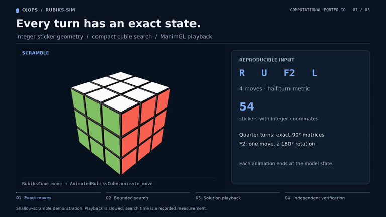

# Rubik's Cube Simulator

A Python project for modelling, solving, and animating Rubik's Cube moves, with optional 3D visualisation using [ManimGL](https://github.com/3b1b/manim).

[](https://raw.githubusercontent.com/ojops/rubiks-sim/8d14100ea3b86da000c6b40d0c78720cfe7ea9d1/docs/media/demo.mp4)

*Preview: a real four move scramble. [Watch the complete 32-second solve (MP4)](https://raw.githubusercontent.com/ojops/rubiks-sim/8d14100ea3b86da000c6b40d0c78720cfe7ea9d1/docs/media/demo.mp4) · [How the video is made](docs/DEMO.md).*

## Overview

Enter moves or generate a reproducible scramble, search for a solution within configurable limits, and animate the result. A sticker model handles geometry, while a compact corner and edge model supports search.

The bounded IDA* solver uses exact coordinate distances as lower bounds. [Recorded successes](docs/BENCHMARKS.md) reach an optimal depth of eight moves, but it does not efficiently solve arbitrary states. The video shows a computed solution verified against the cube model.

## Reproducible benchmark evidence

The [25-case multi-seed benchmark](benchmarks/results/multi-seed.md) compares the original `basic` bound with the `pattern` bound over lengths 4/6/8/10/20 and seeds 0–4, with two repetitions each. Under depth 10, 100,000-node and two-second **warm-search** budgets:

- Basic solved **11/25** cases in both repetitions; pattern solved **15/25**.
- Across the **11 cases solved by both**, the median basic/pattern node ratio was **4.77×**, ranging from **1.00× to 183.42×**. This is a conditional node-count comparison, not an overall runtime speedup.
- The original six-move seed-0 result reproduced: **81,213 vs 1,777 nodes (45.7×)**. It is one case, not a typical improvement claim.
- Every returned solution passed independent sticker-model verification. Unfinished searches remain in the report; a time/node limit is not proof of unsolvability.

Reproduce after installation:

```bash
uv run python benchmarks/suite.py
```

This takes a few minutes and writes JSON plus a Markdown report to `benchmarks/results/multi-seed.*`. Each case/heuristic uses an isolated process, reporting cold table setup separately, warm runtime, nodes, termination status and peak process RSS. RSS includes Python, NumPy, table construction and repeated searches; it is not incremental search memory. Timings and time-limit outcomes vary by machine. This runner uses Unix `resource` and targets Linux/macOS.

For a quick smoke run without overwriting the committed report:

```bash
uv run python benchmarks/suite.py --lengths 4 --seeds 0 --repeats 1 --output /tmp/cube-smoke.json
```

### What to inspect

- `cube.py` / `cubie.py`: independent sticker geometry and compact search state, including physical validity constraints.
- `solver.py` / `patterns.py`: bounded IDA*, the original baseline, and admissible coordinate heuristics.
- `benchmarks/suite.py`: fixed seed grid, isolated workers, explicit budgets and failure-aware summaries.
- `tests/test_benchmark_suite.py`: failure censoring and agreement of returned optimal depths; existing model/search tests check move correctness and heuristics.

The new suite measures the existing solver; it does not introduce a new heuristic or claim efficient arbitrary-state solving. The older [10-case report](docs/BENCHMARKS.md) uses a five-second budget and should not be mixed with the new two-second measurements.

## Features

- Exact sticker geometry and physically validated corner/edge states
- Reproducible scrambles and IDA* search with configurable limits
- Admissible corner/edge coordinate heuristics and a selectable original baseline
- Controlled benchmarks reporting nodes, setup/search time, and termination status
- Solution verification against an independent sticker model
- Command line scrambling, solving, and optional 3D rendering

Solving remains bounded: some ten move sequences and the benchmark twenty move sequence still exhaust the node limit. The scramble length is not necessarily optimal solution depth.

## Requirements and Installation

Requires Python 3.10 and [uv](https://docs.astral.sh/uv/). These commands target Ubuntu or WSL:

```bash
git clone https://github.com/ojops/rubiks-sim.git
cd rubiks-sim
uv sync --locked
```

To animate, install the ManimGL system prerequisites (including FFmpeg, Cairo, and Pango), then run `uv sync --locked --extra render`. Headless Linux rendering may also require Xvfb, xauth, and Mesa.

## Usage

```bash
uv run rubiks-sim --length 20 --seed 42
uv run rubiks-sim --scramble "R U F" --solve
uv run rubiks-sim --scramble "R U F" --solve --max-depth 8 --max-nodes 100000
```

Compare the original heuristic with the default coordinate heuristic:

```bash
uv run rubiks-sim --scramble "R U F2 L" --solve --heuristic basic
uv run rubiks-sim --scramble "R U F2 L" --solve --heuristic pattern
uv run python benchmarks/solver.py --repeats 2
```

The default heuristic builds tables once per process. Setup counts towards CLI elapsed time and time limits, and is reported as `setup_seconds`. See [benchmarks](docs/BENCHMARKS.md) for cold setup, warm searches, memory use, and cases that still reach limits.

The CLI returns JSON, including search statistics and solution verification when solving. Run `uv run rubiks-sim --help` for all options.

Render a scramble followed by its computed solution:

```bash
uv run --extra render rubiks-sim --scramble "R U F" --solve --render --low-quality
```

Output videos go to `videos/` by default. See [demo instructions](docs/DEMO.md) to generate the portfolio MP4 and looping preview.

## Implementation

`src/rubiks_sim/cube.py` tracks stickers, `cubie.py` tracks corners and edges, `solver.py` performs bounded IDA* search, and `sim.py` handles animation. Moves use `U D F B R L`, with optional `'` or `2`. Reaching a search limit **does not** mean a cube is unsolvable.

See [algorithm details](docs/ALGORITHMS.md) for models, validity checks, API behavior, and search assumptions.

## Development Roadmap

Development is incremental, with an emphasis on correct cube states, robust search, and measured performance before more demanding demonstrations.

### Planned

- **Extend measured search coverage beyond the completed 25-case suite:** test more seeds and deeper states. Measure successor generation cost before adding larger edge pattern databases.
- **Evaluate a two-phase solver:** compare coverage, correctness, and complexity with bounded IDA*. Optimal face-turn search and practical arbitrary-state solving have different goals.
- **Demonstrate harder scrambles when supported:** select a reliable case, independently verify it, and render replacement media before updating the portfolio film.
- **Refine animation independently:** improve framing, pacing, and captions without coupling rendering to search.

## Project Structure

```text
rubiks-sim/
├── src/rubiks_sim/
│   ├── cube.py          # Sticker geometry and face turns
│   ├── cubie.py         # Corner/edge states and validation
│   ├── solver.py        # Bounded IDA* solver
│   ├── patterns.py      # Exact coordinate distances and admissible bounds
│   ├── sim.py           # ManimGL visualisation
│   └── main.py          # Command line interface
├── scripts/             # Portfolio video and scene rendering
├── benchmarks/          # Legacy comparison, multi-seed suite and recorded results
├── tests/               # Cube, solver, and rendering tests
├── docs/                # Algorithms, benchmarks, demo, and style notes
│   └── media/           # Preview GIF, MP4, and recorded data
├── pyproject.toml       # Project metadata and dependencies
├── uv.lock              # Locked dependencies
└── README.md
```

The `videos/` directory is created by rendering and is not tracked in Git.

## Development

```bash
uv run pytest
uv run ruff check .
uv run ruff format --check .
uv run python benchmarks/solver.py
```

When changing dependencies, commit both `pyproject.toml` and `uv.lock`. GitHub Actions runs code and rendering checks. See [coding conventions](docs/STYLE.md).

## License

[MIT licensed](LICENSE).
